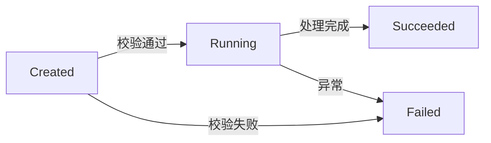

# 飞书可读图表指南

图的作用是让新人更快看懂关系或顺序，不是展示所有技术细节。

## 什么时候保留图

- 三个以上的组件存在清晰依赖或数据流向；
- 一次请求、命令、任务或数据处理有多个先后步骤；
- 系统边界、层级或异常分支用文字难以一遍读懂。

单个事实、一步操作或简单映射直接用短文本即可。不验证单篇图数或总图数。

## 写法

图前用一句正常正文说明“这张图应该怎么看”，图后用一两句点出关键步骤、异常分支或排障入口。不要写 `<!-- diagram-context: before -->` / `after` 等控制标记。

````markdown
从左向右看：外部请求先进入路由层，再交给核心处理。


如果请求没有进入核心处理，先查路由和输入校验，不要直接从数据库开始排查。
````

节点名使用项目真实概念，但要短。中文或特殊字符放在 quoted label 中。

## 飞书 Mermaid 安全子集

根指令只使用：

- `flowchart`
- `graph`
- `sequenceDiagram`

生命周期和状态转换也用 `flowchart` 的节点和条件边表达。禁止 `stateDiagram` 与 `stateDiagram-v2`：它们即使能被标准 Mermaid 渲染，在飞书 Whiteboard 中仍已观察到 `degrade_code=2107`。



本地只检查 fence 和根指令，不调用 `mmdc` 或浏览器渲染器。发布时根据当次写入响应处理明确导入错误，不额外导出或回读画板。
